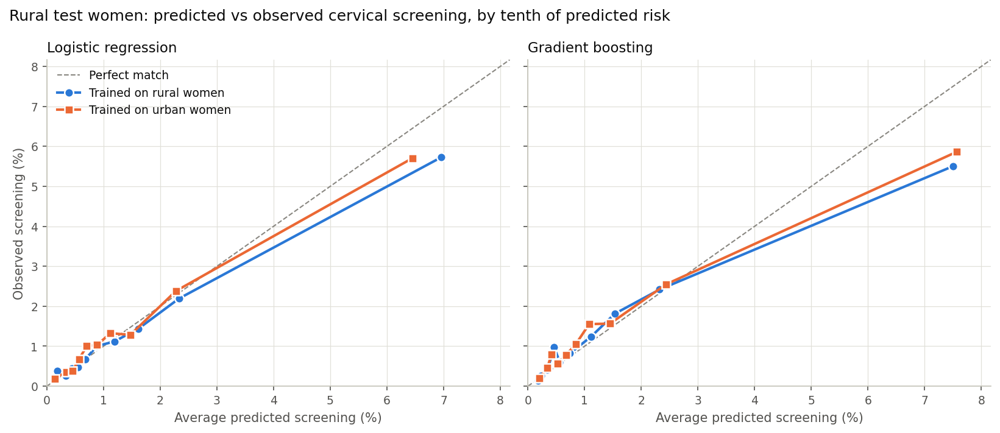

# Cancer screening in India: who is missed, and does a model trained on urban women work for rural women?

An independent analysis of India's National Family Health Survey (NFHS-5, 2019–21) by **Sandhya Shukla**.

## Summary

- Among **364,556 women aged 30–49**, only about **2%** had ever been screened for cervical cancer. Breast and oral cancer screening were below 1%.
- The richest fifth of women were about **2.5 times** as likely to have been screened for cervical cancer as the poorest fifth.
- A model trained only on **urban** women identified screened **rural** women as well as a model trained on rural women: ROC-AUC **0.771 vs 0.769**, a difference of −0.001 (95% CI −0.014 to 0.011).
- The urban-trained model also matched the rural screening rate: **1.66% predicted vs 1.62% observed**. This suggests that measured factors such as wealth, education and state capture most of the urban–rural gap.
- All models over-estimated screening among the women with the highest predicted probabilities (top tenth: about 6.5–7.6% predicted vs 5.5–5.9% observed).

## Data

- **Source:** NFHS-5 (India Demographic and Health Survey 2019–21), women's individual recode file `IAIR7EFL`, conducted by the International Institute for Population Sciences (IIPS) and ICF, and distributed by [The DHS Program](https://dhsprogram.com).
- **The data are not included in this repository.** They are available for research after registering with The DHS Program. DHS data files must not be uploaded or shared.
- **Sample:** women aged 30–49 (`v012`). **Outcome:** ever had a cervical cancer screening test (`sb79`). **Weights:** `v005`. **Clusters:** `v021`.

## Methods

1. **Screening rates** (`01_screening_rates.ipynb`): survey-weighted percentages of women ever screened for cervical, breast and oral cancer, by residence, wealth quintile and education.
2. **Urban-to-rural transfer** (`02_urban_to_rural_transfer.ipynb`):
   - Urban and rural women were each split into training (70%) and test (30%) sets **by cluster**, so women from the same village or city block never appear in both.
   - The two training sets were matched in size (64,782 women each).
   - Logistic regression and histogram gradient boosting were trained with survey weights. Predictors: age, number of children, state, education, religion, wealth quintile, caste/tribe, health insurance, marital status, exposure to newspaper, radio and TV, mobile phone ownership and internet use. Urban/rural residence was not a predictor.
   - Both models were tested on the **same rural test set** (79,118 women in 6,713 clusters) using weighted ROC-AUC, PR-AUC, Brier score, the predicted/observed ratio and calibration by tenths of predicted risk.
   - 95% intervals come from a cluster bootstrap (500 resamples of rural test clusters).

## Results

Rural test women (79,118):

| Model | Trained on | ROC-AUC (95% CI) | Predicted vs observed screening | Predicted/observed (95% CI) |
| --- | --- | --- | --- | --- |
| Logistic regression | Rural women (home) | 0.769 (0.740–0.796) | 1.83% vs 1.62% | 1.128 (1.000–1.275) |
| Logistic regression | Urban women (transfer) | 0.771 (0.742–0.796) | 1.66% vs 1.62% | 1.026 (0.914–1.158) |
| Gradient boosting | Rural women (home) | 0.764 (0.738–0.791) | 1.77% vs 1.62% | 1.093 (0.966–1.233) |
| Gradient boosting | Urban women (transfer) | 0.762 (0.732–0.790) | 1.69% vs 1.62% | 1.045 (0.924–1.183) |

AUC difference, home minus transfer: logistic regression −0.001 (−0.014 to 0.011); gradient boosting 0.003 (−0.013 to 0.019).



The result files (`screening_rates_by_group.csv`, `transfer_results_sb79.csv`, `transfer_bootstrap_95ci_sb79.csv` and `calibration_urban_to_rural_sb79.png`) contain only aggregate numbers. No individual-level NFHS-5 data is included.

## How to run

1. Register with The DHS Program and download the India 2019–21 (NFHS-5) individual recode in Stata format (`IAIR7EFL.DTA`).
2. Install the packages: `pip install -r requirements.txt`
3. Open the notebooks in Jupyter. In the first code cell, set `FOLDER` to the folder that holds `IAIR7EFL.DTA`.
4. Run the cells from top to bottom. Results are saved to `FOLDER/results/`.

## Repository structure

```
01_screening_rates.ipynb            weighted screening rates by group
02_urban_to_rural_transfer.ipynb    urban-to-rural transfer experiment
screening_rates_by_group.csv        screening rates (from notebook 01)
transfer_results_sb79.csv           model scores for each setting (notebook 02, Cell 3)
transfer_bootstrap_95ci_sb79.csv    95% cluster-bootstrap intervals (notebook 02, Cell 4)
calibration_urban_to_rural_sb79.png calibration plot (notebook 02, Cell 5)
requirements.txt
LICENSE
```

## Limitations

- Screening is self-reported.
- The survey is cross-sectional, so the results show associations, not causes.
- The models use only social and demographic predictors; they are suited to finding groups, not to decisions about individuals.
- One train/test split was used; the bootstrap intervals cover variation in the test set only.
- Mobile phone ownership and internet use were recorded for only about 15% of women.

## Next steps

- Survey-weighted logistic regression (odds ratios) for the factors associated with screening
- Transfer across states, a harder kind of shift
- Recalibration and uncertainty estimates for the highest-risk group
- The same analysis for breast cancer screening (`OUTCOME = "sb80"`)

## Data use and acknowledgements

Data from NFHS-5 (IIPS and ICF), accessed through The DHS Program under an approved data-use registration for the project *"Factors associated with breast and cervical cancer screening uptake among women in India: a machine learning analysis of urban–rural differences"*. No attempt was made to identify respondents, and only aggregate results are shown.

I used an AI assistant (Claude) to help write and review the code. I ran all analyses myself and checked the overall screening rate against the official NFHS-5 figure (about 2%).

## License

Code: MIT License (see `LICENSE`). The NFHS-5 data are not covered by this license and remain subject to the DHS terms of use.
